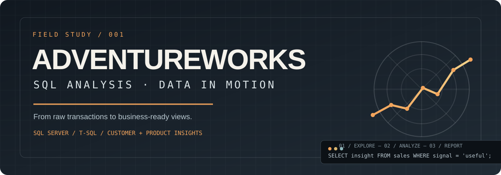

<div align="center">



<br/>


### A practical SQL case study in customer, product, and sales analysis.

[Explore the questions](#-questions-worth-asking) · [Inspect the data model](#-inside-the-model) · [Run the project](#-run-it-yourself)

</div>

---

<table>
<tr>
<td width="58%" valign="top">

### THE INVESTIGATION

Raw transactions rarely explain the business on their own. This project uses the **AdventureWorks bicycle business** to explore sales patterns, compare performance over time, segment customers, and turn query logic into reusable reporting views.

The emphasis is not just on writing SQL that runs. It is on asking a business question, choosing a defensible calculation, and making the result reusable.

</td>
<td width="42%" valign="top">

### PROJECT AT A GLANCE

| | |
|:--|:--|
| **Database** | SQL Server |
| **Language** | T-SQL |
| **Workflow** | Explore → Analyze → Report |
| **Analytical focus** | Sales · Customers · Products |
| **Final outputs** | Customer and product views |

</td>
</tr>
</table>

## ◇ The route through the data

<table>
<tr>
<td width="33%" valign="top">

**<sub>STAGE 01</sub>**

### Discover

Understand the database before analyzing it.

- Inspect tables and dimensions
- Check date ranges
- Identify available measures

</td>
<td width="33%" valign="top">

**<sub>STAGE 02</sub>**

### Investigate

Use SQL to uncover patterns and differences.

- Rankings and magnitude
- Changes over time
- Cumulative and relative performance
- Customer segmentation

</td>
<td width="33%" valign="top">

**<sub>STAGE 03</sub>**

### Package

Move from one-off queries to repeatable outputs.

- Build customer profiles
- Build product summaries
- Create reporting views

</td>
</tr>
</table>

## ◇ Inside the model

The analytical layer is organized around a sales fact table and customer/product dimensions. The reporting views combine useful attributes and derived measures for downstream analysis.

<div align="center">


<sub><b>FIG. 01</b> — Core analytical model · See the <a href="./docs/data_dictionary.md">data dictionary</a> for column definitions, derived metrics, and segmentation rules.</sub>

</div>

<table>
<tr><th align="left">OBJECT</th><th align="left">WHAT IT CONTRIBUTES</th></tr>
<tr><td><code>gold.fact_sales</code></td><td>Transaction-level sales measures</td></tr>
<tr><td><code>gold.dim_customers</code></td><td>Customer attributes for profiling and segmentation</td></tr>
<tr><td><code>gold.dim_products</code></td><td>Product attributes for product-level comparisons</td></tr>
<tr><td><code>gold.report_customers</code></td><td>A consolidated customer reporting view</td></tr>
<tr><td><code>gold.report_products</code></td><td>A consolidated product reporting view</td></tr>
</table>

## ◇ Questions worth asking

<sub>Each question links directly to the SQL script used to investigate it.</sub>

<table>
<tr>
<td width="50%" valign="top">

**01 / PERFORMANCE**

### Is a product doing better than its own history?

Compare product performance with historical averages and prior-year results.

[Open performance analysis ↗](./scripts/02_analysis/09_performance_analysis.sql)

</td>
<td width="50%" valign="top">

**02 / TIME**

### How do sales build over time?

Use cumulative calculations to examine sales and average-price patterns.

[Open cumulative analysis ↗](./scripts/02_analysis/08_cumulative_analysis.sql)

</td>
</tr>
<tr>
<td width="50%" valign="top">

**03 / CUSTOMER VALUE**

### Who are the VIP, Regular, and New customers?

Apply spending and loyalty logic to classify customer behavior.

[Open customer segmentation ↗](./scripts/02_analysis/10_data_segmentation.sql)

</td>
<td width="50%" valign="top">

**04 / CUSTOMER PROFILES**

### What does each customer's profile reveal?

Combine demographic and behavioral attributes into a reusable view.

[Open customer report ↗](./scripts/03_reports/12_report_customers.sql)

</td>
</tr>
<tr>
<td width="50%" valign="top">

**05 / GEOGRAPHY**

### Where is purchasing intensity unusually high?

Rank countries relative to their customer base instead of comparing raw totals alone.

[Open ranking analysis ↗](./scripts/02_analysis/06_ranking_analysis.sql)

</td>
<td width="50%" valign="top">

**06 / PRODUCT MIX**

### Which categories punch above their weight?

Compare each category's revenue contribution with its share of the product catalog.

[Open part-to-whole analysis ↗](./scripts/02_analysis/11_part_to_whole_analysis.sql)

</td>
</tr>
</table>

## ◇ SQL, used with intent

| TOOL / PATTERN | WHY IT IS HERE |
|:--|:--|
| **CTEs** | Break multi-step logic into readable stages |
| **Window functions** — `RANK()`, `LAG()` | Compare entities and periods without losing row-level context |
| **Running totals & moving averages** | Reveal cumulative patterns and smooth short-term variation |
| **`CASE WHEN`** | Turn business rules into explicit categories |
| **Date functions** | Calculate time-based measures |
| **`NULLIF` and zero guards** | Avoid invalid division |
| **`CREATE VIEW`** | Make reporting logic reusable |
| **Magnitude, performance & part-to-whole analysis** | Examine scale, change, and relative contribution |

## ◇ Run it yourself

1. Restore the AdventureWorks database in SQL Server, or adapt the `gold` schema references to your own equivalent model.
2. Run the scripts in folder order: `01_exploratory` → `02_analysis` → `03_reports`. Follow the numbered filenames within each folder.
3. The reporting scripts create `gold.report_customers` and `gold.report_products`.

<details>
<summary><b>Open the project map</b></summary>

```text
adventureworks-sql-analysis/
├── docs/
│   ├── hero.svg
│   ├── erd.svg
│   └── data_dictionary.md
├── scripts/
│   ├── 01_exploratory/
│   ├── 02_analysis/
│   └── 03_reports/
├── LICENSE
└── README.md
```

**Exploratory**
- `01_database_exploration.sql`
- `02_dimensions_exploration.sql`
- `03_date_range_exploration.sql`
- `04_measures_exploration.sql`

**Analysis**
- `05_magnitude_analysis.sql`
- `06_ranking_analysis.sql`
- `07_change_over_time_analysis.sql`
- `08_cumulative_analysis.sql`
- `09_performance_analysis.sql`
- `10_data_segmentation.sql`
- `11_part_to_whole_analysis.sql`

**Reporting**
- `12_report_customers.sql`
- `13_report_products.sql`

</details>

## ◇ Assumptions, limits, next moves

<details>
<summary><b>What I would revisit before production use</b></summary>

- Customer segmentation logic is duplicated in `10_data_segmentation.sql` and `12_report_customers.sql`. If thresholds change, both places need updating.
- Monetary values are treated as one currency because the dataset has no currency code.
- Recency, age, and lifespan use `GETDATE()`, so values change with the run date rather than a fixed reporting date.

**Next iteration:** add data-quality checks for orphaned foreign keys, negative sales amounts, and duplicate order lines; then establish a refresh schedule for the reporting views.

</details>

## ◇ A note on the work

I built this project to move beyond isolated SQL exercises and practice the full analytical sequence: understand the data, translate business questions into explicit logic, and package the results for reuse.

The hardest part is often not the syntax. It is deciding what a label such as “VIP” or “High-Performer” should mean, documenting the assumptions behind it, and making sure another person can inspect the logic. A query can execute successfully and still answer the wrong question.

---

<div align="center">

**Parnaz Ali** · [GitHub profile](https://github.com/ParnazAli)

<sub>Built with SQL Server and T-SQL · Distributed under the MIT License</sub>

</div>
