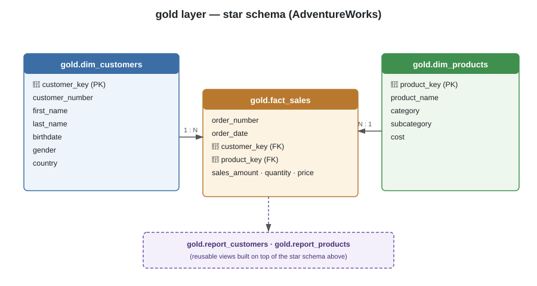

# ADVENTUREWORKS
### SQL FIELD NOTES

**From sales tables to business answers**

SQL SERVER · T-SQL · CUSTOMER & PRODUCT ANALYSIS

---

> **THE BRIEF**
>
> How can raw sales tables become useful business answers? This project explores AdventureWorks, a fictional bicycle manufacturer and retailer, and turns its data into analytical queries and reusable customer and product reports—using SQL from start to finish.

## 01 / The workflow

| PHASE | WHAT HAPPENS |
|:--|:--|
| **01 — Explore** | Inspect tables, dimensions, date ranges, and measures |
| **02 — Analyze** | Investigate rankings, trends, cumulative values, segments, and performance |
| **03 — Report** | Consolidate findings into reusable customer and product views |

<strong>Project scope</strong>

- **Source:** Microsoft AdventureWorks / Adventure Works Cycles
- **Domain:** Bicycle manufacturing and retail
- **Focus:** Products, customers, and sales transactions across multiple years
- **Tooling:** SQL Server and T-SQL; no external BI tool, notebook, or scripting language is used in the workflow

## 02 / The data model

The analysis uses a small star schema: one sales fact table and two dimensions. Reporting views sit above the core model.

FIG. 01 — Core analytical tables and relationships

| DATABASE OBJECT | ROLE |
|:--|:--|
| `gold.fact_sales` | Sales transactions and measures |
| `gold.dim_customers` | Customer attributes for profiling and segmentation |
| `gold.dim_products` | Product attributes for product-level analysis |
| `gold.report_customers` | Consolidated customer reporting view |
| `gold.report_products` | Consolidated product reporting view |

Column definitions, segmentation thresholds, age groups, and derived metrics are documented in the [data dictionary](./docs/data_dictionary.md).

## 03 / Questions behind the queries

<strong>01–03 · Performance, time, and loyalty</strong>

**How does each product perform against its historical average and last year's results?**

→ [Performance analysis](./scripts/02_analysis/09_performance_analysis.sql)

**How do cumulative sales and average prices change over time?**

→ [Cumulative analysis](./scripts/02_analysis/08_cumulative_analysis.sql)

**Which customers are VIP, Regular, or New based on spending and loyalty?**

→ [Customer segmentation](./scripts/02_analysis/10_data_segmentation.sql)

<strong>04–06 · Customer profiles, rankings, and product mix</strong>

**What does each customer's behavioral and demographic profile look like?**

→ [Customer report](./scripts/03_reports/12_report_customers.sql)

**Which countries show unusually high purchasing intensity relative to their customer base?**

→ [Ranking analysis](./scripts/02_analysis/06_ranking_analysis.sql)

**Which product categories generate revenue disproportionately high relative to their share of the catalog?**

→ [Part-to-whole analysis](./scripts/02_analysis/11_part_to_whole_analysis.sql)

## 04 / SQL techniques in practice

| TECHNIQUE | PURPOSE |
|:--|:--|
| CTEs | Structure multi-step queries |
| Window functions such as `RANK()` and `LAG()` | Rank entities and compare periods |
| Running totals and moving averages | Examine cumulative patterns and trends |
| `CASE WHEN` | Define segments and business classifications |
| Date functions | Support time-based calculations |
| `NULLIF` and zero guards | Handle division safely |
| `CREATE VIEW` | Package logic into reusable reports |
| Magnitude, performance, and part-to-whole analysis | Compare scale, change, and relative contribution |

## 05 / Repository map

<strong>Browse the scripts</strong>

    adventureworks-sql-analysis/
    ├── docs/
    │   ├── erd.svg
    │   └── data_dictionary.md
    ├── scripts/
    │   ├── 01_exploratory/
    │   ├── 02_analysis/
    │   └── 03_reports/
    ├── LICENSE
    └── README.md

**Exploratory scripts**
- `01_database_exploration.sql`
- `02_dimensions_exploration.sql`
- `03_date_range_exploration.sql`
- `04_measures_exploration.sql`

**Analysis scripts**
- `05_magnitude_analysis.sql`
- `06_ranking_analysis.sql`
- `07_change_over_time_analysis.sql`
- `08_cumulative_analysis.sql`
- `09_performance_analysis.sql`
- `10_data_segmentation.sql`
- `11_part_to_whole_analysis.sql`

**Reporting scripts**
- `12_report_customers.sql`
- `13_report_products.sql`

## 06 / Run the project

1. Restore AdventureWorks on SQL Server, or adapt the `gold` schema references to your equivalent star schema.
2. Execute scripts in order: `01_exploratory`, `02_analysis`, then `03_reports`. Follow numeric filename order inside each folder.
3. The final scripts create `gold.report_customers` and `gold.report_products` for consolidated reporting.

## 07 / Caveats & next steps

<strong>Implementation notes</strong>

- Customer segmentation logic is duplicated in `10_data_segmentation.sql` and `12_report_customers.sql`; thresholds must be maintained in both if they change.
- Monetary values are treated as a single currency because the dataset carries no currency code.
- Recency, age, and lifespan figures use `GETDATE()`, so they change over time instead of using a fixed reporting date.

**Next improvement:** add data-quality checks for orphaned foreign keys, negative sales amounts, and duplicate order lines, then schedule the reporting-view refresh.

## 08 / Project reflection

I built this project to move beyond tutorial-style SQL exercises and practice the structured thinking that business analysis requires. The workflow—explore the schema, analyze patterns, then package findings into reporting views—helped me approach the work as an end-to-end analysis rather than a collection of queries.

The most valuable challenge was translating broad business questions into precise, defensible logic: what makes a customer “VIP” rather than “Regular,” or a “High-Performer” product rather than an average one? Those decisions require clear business definitions, documented assumptions, and logic that can be reviewed—not simply a query that runs.

---

**Parnaz Ali** · [GitHub profile](https://github.com/ParnazAli)

MIT License · See <a href="./LICENSE">LICENSE</a> for details.

